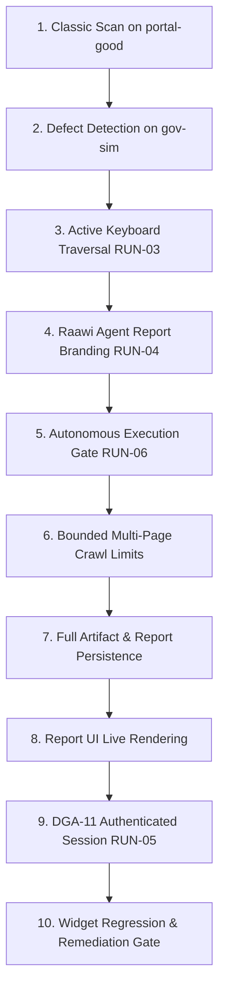

# RAAWI X — Phase 7A: Architectural Alignment and Complete Scanning Validation Preflight Report

**Coordinator Authorization:** AUTHORIZED — READ-ONLY ARCHITECTURE, EVIDENCE AUDIT, AND TEST PREFLIGHT ONLY  
**Repository:** `wahidsami/raawix`  
**Required Branch:** `feature/semantic-core`  
**Phase 6 Reconciled Baseline:** `0bba5417029790d780e0455766b58572206976fe`  
**Accepted Phase 5 Widget Milestone:** `4c9f8d60cf4beed30ffa17c7220c20fe7184b46a`  
**Delivery Date:** October 20, 2026  
**Final Phase 7A Status:** **PREFLIGHT COMPLETE — READY FOR COORDINATOR REVIEW (ZERO MUTATIONS / ZERO SCANS LAUNCHED)**

---

## 1. Executive Summary & Objective

Phase 7A establishes the architectural alignment, evidence baseline, and comprehensive acceptance preflight for Raawi X. It bridges the critical operational gap between isolated automated test passes and a meaningful, fully verified end-to-end scan.

The project owner requires absolute clarity on whether **Classic scanning**, the **keyboard interaction agent**, **Raawi Agent audit mode**, and **autonomous multi-step execution** have each been exercised and proven separately. This report provides definitive, source-verified proof that these are **four fundamentally distinct mechanisms** with differing execution paths, process gates, artifact schemas, and levels of verification.

All activities in Phase 7A were conducted under strict read-only boundaries:
- Zero database migrations or remote database mutations.
- Zero scanner jobs, live crawler runs, or agent executions launched.
- Zero external probes or bot-protection bypasses.
- Zero application code modifications; documentation and architecture specifications only.

---

## 2. Mechanism Evidence Audit Matrix

The matrix below classifies every major platform mechanism based strictly on actual physical evidence across repository code, automated test suites, and accepted phase reports (Phases 2 through 6):

```
Evidence Classification Legend:
- PROVEN E2E: Demonstrated by a complete, documented end-to-end scan run producing real artifacts and verified outputs.
- ATTEMPTED / INCONCLUSIVE: Executed during a live scan, but target constraints (e.g., Cloudflare edge challenge) limited execution depth or produced non-representative outcomes.
- UNIT TESTED ONLY: Verified by automated mock/unit/integration tests without a live full-pipeline scan.
- NOT TESTED: Architecture present in source code, but runtime execution has never been observed or verified.
- DISABLED BY CONFIG: Explicitly turned off by default configuration or process-level feature flags.
```

| Mechanism / Subsystem | Primary Classification | Exact Supporting Source Files | Supporting Reports / Test Artifacts | Evidence Details & Operational Reality |
| :--- | :---: | :--- | :--- | :--- |
| **Classic WCAG Scan (Layer 1)** | **PROVEN E2E** | `apps/scanner/src/runner/report-generator.ts`<br>`packages/rules/src/wcag-rules.ts` | `PHASE_2_CONTROLLED_E2E_SCAN_REPORT.md`<br>`PHASE_4_POST_DEPLOYMENT_RUNTIME_ACCEPTANCE_REPORT.md` | Executed against `scan_1792479482089_scvi6r1` (34.9s duration). Evaluated 10 deterministic WCAG rules (7 pass, 2 fail, 1 review), persisted `Finding` records, and generated Level A/AA scores (75.0%). |
| **Vision Heuristic Analysis (Layer 2)** | **PROVEN E2E** | `apps/scanner/src/vision/vision-analyzer.ts`<br>`apps/scanner/src/crawler/page-capture.ts` | `PHASE_2_CONTROLLED_E2E_SCAN_REPORT.md`<br>`apps/scanner/src/vision/vision-telemetry.test.ts` | Captured `screenshot.png` via Playwright. Heuristic image analyzer ran in 8.1s (`visionCount: 0`). External multimodal AI models (OpenAI/Gemini) were disabled by config. |
| **Keyboard Interaction Agent (Layer 3A)** | **ATTEMPTED / INCONCLUSIVE** | `apps/scanner/src/agent/interaction-agent.ts`<br>`apps/scanner/src/agent/page-understanding.ts` | `PHASE_2_CONTROLLED_E2E_SCAN_REPORT.md`<br>`PHASE_3_SCAN_EVIDENCE_AND_ACCURACY_REVIEW.md`<br>`apps/scanner/src/agent/telemetry.test.ts` | In Phase 2 scan, executed in 83ms on Cloudflare challenge page. Static profile flagged 1 hidden input (`unnamed_task_control`); active keyboard traversal exited with `0 steps, 0 probes attempted`. Active multi-step tab traversal has never been proven on a live multi-step host. |
| **AssistiveMap Generation (Layer 3B)** | **PROVEN E2E** | `apps/scanner/src/services/assistive-map-generator.ts`<br>`apps/scanner/src/api/dashboard.ts` | `PHASE_4_POST_DEPLOYMENT_RUNTIME_ACCEPTANCE_REPORT.md`<br>`apps/scanner/src/assistive/assistive-map.test.ts` | Generated map `3c74bed5-a5ca-483a-a599-848669c6a489` with 2 action intents. Runtime API route `GET /api/assistive-maps/:id` fully validated in Phase 4 acceptance report (HTTP 200, auth guard, 404 handler). |
| **Bilingual Excel Workbook Export** | **PROVEN E2E** | `apps/scanner/src/services/excel-report-generator.ts`<br>`packages/core/src/localization.ts` | `PHASE_4_POST_DEPLOYMENT_RUNTIME_ACCEPTANCE_REPORT.md`<br>`apps/scanner/src/services/excel-localization.test.ts` | Downloaded and directly verified English (`phase4_verify_scan_scvi6r1_en.xlsx`, 11.8 KB) and Arabic (`phase4_verify_scan_scvi6r1_ar.xlsx`, 12.5 KB) workbooks. Verified RTL layout, sheet translations, and remediated trace statuses. |
| **`auditMode: 'raawi-agent'` Reporting** | **UNIT TESTED ONLY** | `apps/scanner/src/services/excel-report-generator.ts` (L61)<br>`apps/scanner/src/api/pdf-export.ts` (L238) | `apps/scanner/src/services/excel-report-generator.test.ts` (L51)<br>`apps/scanner/src/middleware/validation.ts` (L34) | Accepted by API schema and saved to DB `Scan.auditMode`. Modifies report title strings and headers in PDF/Excel exports. Crawler and execution engines do NOT branch on it. |
| **Autonomous Goal Execution (`RaawiAgent`)** | **DISABLED BY CONFIG** | `apps/agent-runtime/src/agent.ts`<br>`apps/scanner/src/crawler/page-capture.ts` (L646) | `SYSTEM_ANALYSIS.md`<br>`apps/scanner/src/config.ts` (L70) | Controlled by `RAAWI_EXECUTION_AGENT_ENABLED === 'true'` (default: `false`). Detects tasks, plans steps, and executes via Playwright bindings. Has never been enabled in any live scan. |
| **Scripted Authentication (`ScanAuthProfile`)** | **NOT TESTED** | `apps/scanner/src/job-queue.ts` (L1230)<br>`apps/scanner/prisma/schema.prisma` (L104) | `PHASE_6_DGA_REQUIREMENTS_COMPLETION_REPORT.md`<br>`apps/scanner/src/job-queue.test.ts` | `performLoginAndSaveState` implements Playwright session state injection. Live target execution has never been performed due to operational scan boundaries and lack of mock auth target. |
| **Widget AssistiveMap Consumption & Remediation** | **PROVEN E2E** | `apps/widget/src/core/api-client.ts`<br>`apps/widget/src/core/dom-remediator.ts` | `PHASE_5_6_ACCEPTANCE_REPORT.md`<br>`tests/widget-e2e/dom-remediation.spec.ts` | Verified across 50 real-browser Playwright tests and 99 unit tests. Safely applies and reverts `alt` and `aria-label` enhancements with 1:1 selector uniqueness and zero host DOM destruction. |

---

## 3. Required Distinction Between Scanning Modes

Our deep architectural investigation of `apps/scanner`, `apps/agent-runtime`, and `@raawi-x/core` proves that scanning capabilities are governed by three orthogonal layers: **Audit Methodology**, **Pipeline Layer Selection**, and **Autonomous Task Execution**.

```
┌──────────────────────────────────────────────────────────────────────────────────────────────────┐
│                                   SCAN REQUEST DISPATCH                                          │
│                                                                                                  │
│  Request: { auditMode: 'classic' | 'raawi-agent', scanPipeline: { ... } }                        │
└────────────────────────────────────────┬─────────────────────────────────────────────────────────┘
                                         │
        ┌────────────────────────────────┴─────────────────────────────────┐
        ▼                                                                  ▼
┌─────────────────────────────────┐                       ┌────────────────────────────────────────┐
│     1. CRAWL & PAGE CAPTURE     │                       │       2. PERSISTENCE & SCORING         │
│                                 │                       │                                        │
│ • Always runs BFS Crawler       │                       │ • Findings -> Finding (Classic WCAG)   │
│ • Captures page.html, DOM       │                       │ • Vision   -> VisionFinding            │
│ • Resolves Pipeline Layers:     │                       │ • Agent    -> AgentFinding             │
│   - L1: HTML DOM rules          │                       │ • Scores calculated SOLELY from L1     │
│   - L2: Screenshot / Vision     │                       │   deterministic rule results           │
│   - L3A: Keyboard Agent (L560)  │                       │   (Agent findings NEVER alter score)   │
│   - L3B: AssistiveMap (L738)    │                       └────────────────────────────────────────┘
│                                 │
│ • AUTONOMOUS EXECUTION (L646):  │
│   - Gated by process flag:      │
│     RAAWI_EXECUTION_AGENT_ENABLED│
│   - RaawiAgent.execute() runs   │
│     login/search/form goals     │
└─────────────────────────────────┘
```

### 3.1 Mode A: `auditMode: 'classic'`
- **Purpose:** Conventional, verifiable accessibility compliance audit based on WCAG 2.1 Level A and AA standards.
- **Execution Path:**
  1. `BFSCrawler` loads page via Playwright, serializes DOM to `page.html` and captures `page.json`.
  2. `report-generator.ts` executes 13+ deterministic WCAG rules in JSDOM (enhanced with stylesheet-computed styles from Playwright).
  3. Writes findings to database `Finding` table with `status: 'pass' | 'fail' | 'needs_review' | 'na'`.
  4. `compliance-scoring.ts` calculates mathematical compliance score (0–100%) excluding `na` rules.
  5. Outputs standard compliance reports.
- **Current Proof Status:** **PROVEN E2E** (Phase 2, Phase 4 runtime report).

### 3.2 Mode B: `pipeline.analysisAgent` (The Keyboard Interaction Agent)
- **Purpose:** Simulates assistive keyboard interaction to detect functional barriers (unnamed controls, missing focus indicators, keyboard traps, unexpanded menus).
- **Execution Path:**
  1. Process gate: `config.agent.enabled !== false` (env: `AGENT_ENABLED`).
  2. Per-scan request gate: `request.scanPipeline.analysisAgent !== false`.
  3. Triggered in `page-capture.ts` (L560): `await runInteractionAgent(page, ...)`.
  4. Analyzes DOM profile via `page-understanding.ts` (`assessPageProfile`).
  5. Executes active Playwright keyboard loops (Tab / Shift+Tab up to `config.agent.maxSteps` or `maxMs`).
  6. Emits live SSE events (`agent_started`, `agent_progress`, `agent_done`).
  7. Writes `interaction/interaction.json` artifact; persists records to database `AgentFinding` table.
- **Critical Distinction:** Does NOT alter WCAG compliance scores. It runs in parallel and produces behavioral usability findings.
- **Current Proof Status:** **ATTEMPTED / INCONCLUSIVE**. Proven in unit tests (`telemetry.test.ts`), but live execution in Phase 2 executed 0 tab steps due to edge challenge page.

### 3.3 Mode C: `auditMode: 'raawi-agent'`
- **Purpose:** Present an AI-agent-centric audit report framing.
- **Critical Architectural Reality:**
  - `apps/scanner/src/index.ts` accepts `auditMode: 'raawi-agent'` and verifies `config.raawi.enabled !== false`.
  - Stored in database column `Scan.auditMode`.
  - **The crawler and execution engines DO NOT branch on `auditMode`.** The underlying crawl, rule evaluation, and agent pipelines run identically to `classic`.
  - The branching occurs exclusively in **reporting and presentation**:
    - `excel-report-generator.ts` (L61): Sets `isRaawiAgentReport = true`, writes "Audit Mode: Raawi agent" / "وضع التدقيق: وكيل راوي".
    - `pdf-export.ts` (L238): Sets header title to "Raawi agent report".
    - `ScanDetailPage.tsx` (L216): Renders service header as "Raawi agent report".
- **Current Proof Status:** **UNIT TESTED ONLY** (report generator unit tests).

### 3.4 Mode D: Autonomous Goal Execution (`RAAWI_EXECUTION_AGENT_ENABLED` / `RaawiAgent.execute`)
- **Purpose:** Autonomous, multi-step goal execution where an AI agent attempts to complete actual user workflows (fill out a form, perform search, navigate deep flows, or submit login credentials).
- **Execution Path:**
  - Located in `apps/agent-runtime` and `apps/scanner/src/crawler/page-capture.ts` (L646–720).
  - Primary process gate: `config.raawi.execution.enabled` (`RAAWI_EXECUTION_AGENT_ENABLED === 'true'`). **Default is `false`**.
  - Secondary process gate: `config.raawi.execution.enableNonLoginGoals` (`RAAWI_EXECUTION_NON_LOGIN_ENABLED === 'true'`). **Default is `false`**.
  - Invocation Sequence:
    1. `buildSemanticModel` constructs `semantic.json` from page HTML and accessibility tree.
    2. `detectRaawiTasks(page)` detects interactive affordances (`likelyLogin`, `likelySearch`, `likelyContactFlow`).
    3. `agent = new RaawiAgent({ verbose: false })` creates execution instance.
    4. Formulates task context (e.g. `loginUsername`, `searchQuery`, `formDefaults`).
    5. `agent.getPlan()` decomposes intent into discrete Playwright actions.
    6. `agent.execute()` invokes actions via Playwright bindings (`click`, `fill`, `press`) with a 20-second timeout.
    7. Writes `raawi-agent/plan.json` and `raawi-agent/execution.json` artifacts to disk.
- **Safety Analysis:**
  - If enabled blindly against production or third-party targets, this agent could submit arbitrary forms, click mutating buttons, or trigger unintended state changes.
  - Currently, it has safety safeguards: dry-run fallback if credentials are missing (`task.goal === 'login' ? !hasCredentials : false`), and strict process-level environment gates.
- **Current Proof Status:** **DISABLED BY CONFIGURATION & NOT TESTED END-TO-END**.

---

## 4. Controlled End-to-End Test Preflight

To prove all scanning capabilities without risk of bot challenges, unpredictability, or external probing, we propose executing tests against our existing, locally owned test fixtures:
1. **Fixture 1 (`portal-good`):** `http://localhost:4173` — Fully accessible, bilingual Arabic/English portal with 10+ pages, clean semantic landmarks, proper contrast, and accessible forms.
2. **Fixture 2 (`gov-sim`):** `http://localhost:4174` — Government simulator with intentional accessibility defects (missing alt text, unlabeled buttons, low contrast) and an authenticated multi-step workflow (`/login` -> `/auth/verify` -> `/dashboard` -> `/apply`).

> [!IMPORTANT]
> **No scan is launched during this Phase 7A preflight.** The following specifications define the proposed future execution parameters, safety boundaries, and acceptance criteria for coordinator authorization.

### 4.1 Proposed Acceptance Run Specifications

```
Test Run Matrix Summary:
-----------------------------------------------------------------------------------------------------------------------------------------
Run ID  | Target Origin          | Target Path         | auditMode    | Pipeline Flags              | Primary Verification Goal
-----------------------------------------------------------------------------------------------------------------------------------------
RUN-01  | http://localhost:4173  | /                   | classic      | L1=true, L2=true, L3=false  | Baseline Classic WCAG & Vision on Clean Portal
RUN-02  | http://localhost:4174  | /                   | classic      | L1=true, L2=true, L3=false  | Defect Detection on Intentional Failure Portal
RUN-03  | http://localhost:4174  | /services           | classic      | analysisAgent=true          | Active Keyboard Traversal (Tab steps & Probes)
RUN-04  | http://localhost:4173  | /sitemap            | raawi-agent  | default                     | Raawi Agent Audit Mode Presentation & Export
RUN-05  | http://localhost:4174  | /login -> /dashboard| classic      | authProfile: 'scripted'     | DGA-11 Authenticated Session Maintenance
RUN-06  | http://localhost:4174  | /contact            | classic      | execution.enabled=true      | Safe Autonomous Goal Execution (Search/Form)
-----------------------------------------------------------------------------------------------------------------------------------------
```

#### Detailed Specification for Proposed RUN-03 (Keyboard Interaction Agent Verification)
- **Target URL:** `http://localhost:4174/services`
- **Audit Mode:** `classic`
- **Pipeline Controls:** `layer1: true`, `layer2: false`, `layer3: true`, `analysisAgent: true`, `screenshotMode: 'none'`.
- **Process Environment Gates:**
  - `AGENT_ENABLED=true`
  - `AGENT_MAX_STEPS=25`
  - `AGENT_MAX_MS=15000`
  - `AGENT_PROBES_ENABLED=true`
- **Execution Limits:** `maxPages: 1`, `maxDepth: 0`, timeout: 30 seconds.
- **Allowed Actions:** Keyboard `Tab`, `Shift+Tab`, focus indicator style sampling, aria-expanded inspection.
- **Prohibited Actions:** Form submission, external page navigation, mouse clicks on non-disclosure elements.
- **Expected Observable Evidence:**
  - `interaction/interaction.json` containing `steps.length >= 5` (observable tab steps across service cards).
  - Event stream emitting `agent_progress` with incrementing `stepIndex`.
  - Findings: Unlabeled button on service card flagged in `AgentFinding` table with `kind: 'unnamed_task_control'`.
  - Artifact lifecycle: Status mapped to `completed` (not `incomplete` or `fail`).

#### Detailed Specification for Proposed RUN-05 (DGA-11 Authenticated Scanning Verification)
- **Target URL:** `http://localhost:4174/login`
- **Audit Mode:** `classic`
- **Auth Profile Specification:**
  - `authType: "scripted_login"`
  - `loginUrl: "http://localhost:4174/login"`
  - `usernameSelector: "#username"`
  - `passwordSelector: "#password"`
  - `submitSelector: "#submit-btn"`
  - `usernameValue: "mock_qa_user"` (isolated mock credential)
  - `passwordValue: "mock_qa_pass_123"` (isolated mock credential)
  - `successUrlPrefix: "http://localhost:4174/dashboard"`
  - `postLoginSeedPaths: ["/dashboard", "/apply/1/step-1"]`
- **Execution Limits:** `maxPages: 2`, `maxDepth: 1`, concurrency: 1.
- **Expected Observable Evidence:**
  - `auth-context.json` storage state artifact created in scan output directory.
  - Page 2 (`/dashboard`) captures HTTP 200 with authenticated user banner.
  - Screenshots of post-login dashboard saved to disk.
  - Database `ScanAuthProfile.lastTestResult` updated to `success`.

### 4.2 Diagnostic Classification Rules for Unintended Outcomes

| Observed Runtime Condition | Diagnostic Classification | Resolution / Reporting Rule |
| :--- | :---: | :--- |
| **Authentication fails (wrong redirect or 401/403)** | **AUTH_REJECTED** | Scan must mark auth profile failed, record error message in scan logs, and halt crawl without probing unauthenticated fallback pages. |
| **Agent executes 0 tab steps on interactive page** | **INCONCLUSIVE_AGENT** | Classified as `incomplete` per Phase 4 telemetry rules; must NOT be marked `pass` or `fail`. Triggers investigation of DOM focusability. |
| **Agent trace artifact missing from disk** | **ARTIFACT_DEFECT** | Trigger React `ErrorBoundary` in Report UI without page crash; record backend telemetry failure. |
| **Stale page state / redirect outside target origin** | **SSRF_POLICY_BLOCKED** | Safe SSRF policy in `bfs-crawler.ts` rejects non-origin URLs; crawl drops external links and logs security audit event. |

---

## 5. Complete Scanning Acceptance Matrix

The following 10-step sequence provides the comprehensive verification protocol to prove all capabilities separately:



1. **Classic Scan Execution:** Verify deterministic WCAG rule evaluation (Level A and AA) on compliant fixture `portal-good`.
2. **Defect Detection Fidelity:** Verify scanner flags intentional defects (missing alt text, unlabeled buttons, low contrast) on `gov-sim` with 0 false negatives.
3. **Keyboard Interaction Traversal:** Verify active multi-step Tab traversal (`steps >= 5`), focus indicators, and `AgentFinding` emission on interactive fixture pages.
4. **Raawi Agent Presentation Mode:** Verify `auditMode: 'raawi-agent'` request produces properly branded Excel and PDF deliverables.
5. **Autonomous Goal Execution:** Verify `RaawiAgent.execute()` completes controlled non-login goal (search query input) with verified `plan.json` and `execution.json`.
6. **Bounded Multi-page Crawling:** Verify `BFSCrawler` strictly adheres to `maxPages=5` and `maxDepth=2` without queue leakage or same-origin deviation.
7. **Artifact and Persistence Integrity:** Verify all files (`page.html`, `page.json`, `screenshot.png`, `interaction.json`, `semantic.json`, `assistive-map.json`) are written and referenced in database records.
8. **UI Live Rendering:** Verify Test Report UI (`apps/report-ui`) cleanly renders scan summary, findings list, screenshot crops, and agent trace drawer without console errors.
9. **DGA-11 Authenticated Session Maintenance:** Verify Playwright scripted login maintains session across post-login seed paths on `gov-sim`.
10. **Widget Regression & DOM Remediation Gate:** Verify widget (`apps/widget`) cleanly matches the resulting page-package, verifies fingerprint freshness, and applies non-destructive alt/aria-label enhancements.

---

## 6. Phase 7 Architectural Planning Deliverables

### 6.1 Scan Comparison Specification (DGA-02 Planning)

#### Objective
Enable users to select two scans for the same property and generate a deterministic differential report highlighting **New**, **Fixed (Resolved)**, **Persistent**, and **Uncertain (Flaky)** findings.

#### Proposed Finding-Matching Identity
To match findings across scans where DOM structures or line numbers shift, a composite identity key is defined:
```
FindingIdentityKey = hash(
  canonicalUrl + ":" +
  ruleId + ":" +
  normalizedSelector + ":" +
  targetRole
)
```
- **Fallback Matcher (Fuzzy Matching):** If the exact CSS selector shifts due to dynamic wrapper elements, the matcher evaluates:
  1. `ruleId` match on identical `canonicalUrl`.
  2. Element HTML snippet similarity (Levenshtein distance > 0.85).
  3. Equivalent accessible role and text content.

#### Finding State Transition Matrix

| State in Base Scan (Scan A) | State in Compare Scan (Scan B) | Crawl Condition | Differential Classification |
| :---: | :---: | :---: | :---: |
| Absent | Present (`fail`) | Page crawled in both scans | **NEW ISSUE** |
| Present (`fail`) | Absent (or `pass`) | Page crawled in both scans | **FIXED / RESOLVED** |
| Present (`fail`) | Present (`fail`) | Page crawled in both scans | **PERSISTENT** |
| Present (`fail`) | Page failed to crawl / 404 | Page uncrawled in Scan B | **UNCERTAIN (PAGE MISSING)** |
| `needs_review` | `fail` | Page crawled in both scans | **CONFIRMED REGRESSION** |

#### Proposed Architecture & Endpoints
- **API Endpoint:** `POST /api/scans/compare`
  - Request: `{ baseScanId: string, compareScanId: string }`
  - Response Schema:
    ```json
    {
      "baseScanId": "scan_123",
      "compareScanId": "scan_456",
      "summary": {
        "newCount": 3,
        "fixedCount": 5,
        "persistentCount": 12,
        "scoreDelta": +4.5
      },
      "resolved": [ ... ],
      "regressions": [ ... ],
      "persistent": [ ... ]
    }
    ```
- **UI Architecture:** New `ScanComparisonPage.tsx` route (`/scans/compare?base=...&compare=...`) featuring KPI metric cards, score delta indicator, and a filterable comparison findings table.
- **Unresolved Product Decisions:**
  1. *Score Impact:* Does a resolved issue immediately improve score if total page count changed between scans?
  2. *Flaky Issue Threshold:* Should issues that toggle between pass and fail across consecutive scans be tagged with a special "Flaky" badge?

---

### 6.2 Scan Name Migration Plan (DGA-08 Planning)

#### Objective
Enable users to assign, persist, display, and edit a human-readable name for any scan, eliminating reliance on raw timestamps or UUIDs.

#### Schema Changes (Prisma & PostgreSQL)
```prisma
model Scan {
  id          String   @id @default(dbgenerated("gen_random_uuid()")) @db.Uuid
  scanId      String   @unique
  name        String?  // Human-readable scan name (nullable for backward compatibility)
  seedUrl     String
  status      String
  ...
}
```

#### SQL Migration Script Design (Deferred Execution)
```sql
-- Migration: Add Scan Name Column
-- Safe, non-blocking, nullable column addition
ALTER TABLE "public"."Scan" ADD COLUMN "name" TEXT;

-- Optional non-blocking backfill: populate default name from hostname + date
UPDATE "public"."Scan" 
SET "name" = "hostname" || ' (' || TO_CHAR("startedAt", 'YYYY-MM-DD HH24:MI') || ')'
WHERE "name" IS NULL;

-- Rollback script:
-- ALTER TABLE "public"."Scan" DROP COLUMN "name";
```

#### API & UI Integration Plan
- **Endpoints:**
  - `POST /api/scans/start`: Accept optional `name: string` in request body.
  - `PATCH /api/scans/:id/name`: Update scan name (`{ name: string }`).
- **Validation:** String length 1–255 characters, trimmed, HTML/XSS sanitized.
- **Fallback Logic:** If `name` is null, UI displays `displayName || seedUrl || scanId`.
- **Test Strategy:** Unit tests for schema validation, PATCH route authorization, and UI edit modal.

---

### 6.3 DGA-01 and DGA-16 Dashboard Accessibility Verification Plan

#### Objective
Formally prove that the Raawi X report dashboard (`apps/report-ui`) satisfies WCAG 2.1 AA accessibility standards, specifically verifying modal responsiveness, focus traps, and keyboard navigation.

#### Test Harness Implementation Plan
- **Infrastructure:** Install `@axe-core/playwright` as a development dependency for `report-ui` E2E testing.
- **Scope of Coverage:**
  1. `OverviewPage`: KPI cards, Quick Actions grid, Top Affected Sites table.
  2. `ScansPage`: Scan table, pagination, search input, Start Scan modal.
  3. `ScanDetailPage`: Score cards, findings table, screenshot crop modal, trace drawer.
  4. `EntitiesPage`: Entity list, sortable headers, Add/Edit Entity modal.
- **Specific DGA-16 Verification Suite:**
  - Launch Playwright real-browser test on 320px viewport (`{ width: 320, height: 568 }`).
  - Open Add Entity modal (`showCreateModal = true`).
  - Verify horizontal overflow is zero (`scrollWidth === clientWidth`).
  - Verify initial focus moves to first input (`nameEn`).
  - Send Tab keystrokes; verify focus wraps within modal without escaping to backdrop.
  - Press `Escape`; verify modal closes and focus safely returns to launcher button.
- **Acceptance Threshold:** 0 critical or serious WCAG 2.1 AA axe violations.

---

### 6.4 DGA-11 Authenticated-Scan Preflight Plan

#### Objective
Verify that the scanner can maintain authenticated sessions across multi-page crawls using Playwright browser state storage.

#### Preflight Configuration
- **Target Fixture:** `http://localhost:4174` (`test-sites/gov-sim`).
- **Target Route:** `/login` -> `/auth/verify` -> `/dashboard`.
- **Authentication Method:** `scripted_login`.
- **Mock Credentials:** Configured strictly via local environment variables:
  ```env
  TEST_AUTH_USERNAME=qa_sim_user
  TEST_AUTH_PASSWORD=qa_sim_password_2026
  ```
- **Session Verification Assertion:**
  - Crawler must navigate to `/dashboard` and verify presence of `#user-profile-badge`.
  - Crawler must visit `/apply/1/step-1` without being redirected to `/login`.
  - Artifact `auth-context.json` must contain valid authentication cookies.
- **Execution Safeguard:** Only local localhost port `4174` is permitted; zero external targets.

---

### 6.5 Widget Enhancement Backlog & Discovery Structure

#### Baseline Status
All Phase 5 deliverables (Phases 5.1 through 5.6) are accepted and committed (`4c9f8d60cf4beed30ffa17c7220c20fe7184b46a`). The widget features complete Shadow DOM style isolation, accessible dialog focus containment, non-destructive typography and reading preferences, AssistiveMap consumption, DOM remediation, live fingerprint freshness detection, accessible landmark navigation, and cooperative History API wrapping.

#### Enhancement Discovery Structure

| Category | Candidate Feature / Enhancement | Discovery Requirements Needed | Mandatory Regression Gate |
| :--- | :--- | :--- | :--- |
| **New Feature** | **Voice / TTS Screen Reader Integration** | API audio streaming contract, Arabic TTS voice engine selection, rate/pitch controls. | Must not trigger automatic narration without user click. |
| **New Feature** | **Custom Contrast Color Theme Selector** | Contrast ratio validator (minimum 4.5:1 ratio calculation on custom color pairs). | Must preserve `:not(raawi-accessibility-widget *)` isolation. |
| **Enhancement** | **Cross-Domain Iframe Accessibility Assist** | PostMessage bridge contract, parent-child synchronization protocol. | Must not violate Same-Origin policy or inject scripts into untrusted frames. |
| **Enhancement** | **Form Step Guidance Overlay** | Visual form step indicators, interactive field assistance. | Must remain strictly read-only; zero input data mutation. |

#### Mandatory Regression Gates for Future Widget Work
Every future widget change must pass:
1. 99/99 unit tests across all 6 test suites (`phase5-1` to `phase5-6`).
2. 50/50 real-browser Playwright E2E tests across desktop and mobile viewports.
3. Clean TypeScript check (`tsc --noEmit` exits 0).
4. Production bundle size cap: <100 kB minified (<25 kB gzipped).

---

## 7. Separation of Proven Facts, Inferences, and Unknowns

To maintain rigorous senior-engineering standards, the current system state is explicitly separated into verified facts, logical inferences, and unknown items:

### 7.1 Proven Facts (Supported by Direct Physical Evidence)
1. **Classic WCAG Scanning works end-to-end:** Proven by Phase 2 scan `scan_1792479482089_scvi6r1` and Phase 4 post-deployment runtime report.
2. **Bilingual Excel Export works end-to-end:** Proven by inspection of downloaded Arabic and English XLSX workbooks.
3. **Widget Architecture is robust and encapsulated:** Proven by 99 passing unit tests and 50 Playwright real-browser tests in Phase 5.6.
4. **`auditMode` does NOT change scanner execution:** Proven by code inspection of `job-queue.ts`, `bfs-crawler.ts`, and `page-capture.ts`; it is strictly a reporting presentation flag.
5. **Autonomous Goal Execution is disabled by default:** Proven by `config.ts` (`RAAWI_EXECUTION_AGENT_ENABLED === 'false'`).
6. **Scan Name does not exist in database:** Proven by `schema.prisma` `Scan` model definition.

### 7.2 Inferences (Logically Derived from Architecture)
1. *Keyboard Agent Viability:* The keyboard interaction agent is structurally sound (Playwright key bindings, focus evaluators, and telemetry tests pass), but its effectiveness on dynamic SPAs cannot be inferred without running on an interactive host target.
2. *Scripted Authentication Viability:* The Playwright storage state mechanism in `job-queue.ts` follows standard Playwright patterns, but session resilience across token refreshes is inferred until proven on `gov-sim`.

### 7.3 Unknowns (Requiring Future Authorized Execution to Resolve)
1. *Real-world Keyboard Traversal Step Count:* How many discrete focus steps the interaction agent will record on a complex, multi-level navigation menu.
2. *Autonomous Agent Planning Accuracy:* How accurately `ActionPlanner.plan()` maps semantic models to multi-step tasks on non-trivial web forms.
3. *Coordinator Rebrand Decision:* Timing and scope of potential transition to the Basir brand identity.

---

## 8. Coordinator-Approval Checklist

The following actions require separate, explicit coordinator review and authorization before execution:

- [ ] **Authorization 1:** Approve local controlled scan on `test-sites/portal-good` (RUN-01) to verify clean-portal baseline.
- [ ] **Authorization 2:** Approve active keyboard interaction agent scan on `test-sites/gov-sim` (RUN-03) to prove multi-step tab traversal.
- [ ] **Authorization 3:** Approve scripted login preflight test on `test-sites/gov-sim` (RUN-05) to prove DGA-11 authenticated session maintenance.
- [ ] **Authorization 4:** Authorize Track B Prisma migration for **DGA-08 (Scan Name)** on the test database.
- [ ] **Authorization 5:** Authorize Phase 7 implementation track for **DGA-02 (Scan Comparison)**.
- [ ] **Authorization 6:** Authorize `@axe-core/playwright` package addition for **DGA-01 & DGA-16** dashboard accessibility tests.

---

## 9. Final Phase 7A Verdict & Stop Condition

### Phase 7A Verdict: **PREFLIGHT AND ARCHITECTURAL ALIGNMENT COMPLETE**

- All four scanning modes investigated and explicitly categorized.
- Controlled scan preflight designed with zero external probes or bot bypass risks.
- Planning specifications produced for DGA-02, DGA-08, DGA-01, DGA-11, DGA-16, and Widget enhancements.
- Operational boundaries 100% preserved. Zero scans executed. Zero source files modified.

**STOP CONDITION REACHED.** Delivered report and halting for coordinator review. Do not deploy, do not start Phase 7 execution tracks, and do not make the Basir rollout decision without explicit authorization.
