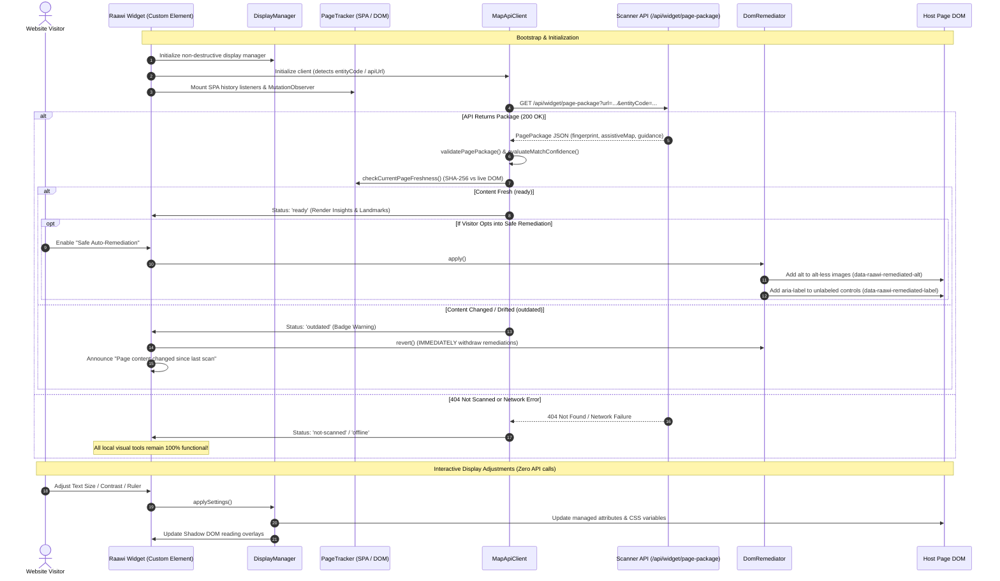
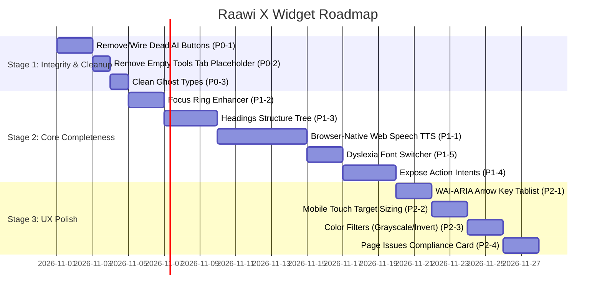

# Raawi X — Widget Capability Audit
## What We Actually Have, What's Missing, and How to Make It Exceptional

**Audit Date:** 2026-10-22  
**Repository:** `wahidsami/raawix`  
**Branch:** `feature/semantic-core`  
**Inspected Commit:** `861a8e95d582dd64e0a2f3e03501751bbba03d7e`  
**Working Tree Status:** Clean  
**Scope:** `apps/widget/` (and related shared contracts in `packages/core/`, `packages/semantic-engine/`, and `apps/scanner/`)

---

## 1. Executive Summary

This capability audit provides a ground-truth, evidence-based assessment of the Raawi X accessibility widget as it exists in the codebase today. It separates working visitor features from code that exists only in legacy prototypes, test mocks, or unattached UI placeholders.

### Key Audit Findings

1. **Clean Modern Architecture for Visual Tools & Core Controls:**
   In Phase 5.1–5.6, the widget was successfully refactored from a monolithic 340 KB prototype (`widget.legacy.ts`) into a modern, modular Web Component (`apps/widget/src/core/shadow-container.ts`). It uses an open Shadow DOM root, an inline SVG launcher (< 1.5 KB), strict CSS scoping, a complete bidirectional WAI-ARIA focus trap (Tab/Shift+Tab), Escape dismissal, and bilingual localization (Arabic RTL and English LTR).

2. **Strong, Safe, Non-Destructive Visual Toolset (100% Deterministic / Zero Gemini Credits):**
   The widget provides an exceptional, fully reversible suite of client-side visual aids: proportional text scaling (80%–200%), proportional line spacing (80%–200%), a curated WCAG AAA 21:1 high-contrast dark mode, animation suppression with automatic HTML5 video pause/resume tracking, high-visibility SVG cursors, image hiding, and Shadow DOM-contained reading overlays (horizontal reading guide ruler and adjustable reading focus mask). All of these operate locally in the browser, require zero API calls, and consume zero Gemini quota.

3. **Conservative, Opt-in DOM Remediation:**
   Unlike aggressive third-party accessibility overlays that overwrite host semantics, Raawi X's `DomRemediator` is **strictly opt-in** (`remediationEnabled` defaults to `false`). It only consumes scanner-vetted `imageDescriptions` and `labelOverrides` with confidence ≥ 0.65. It strictly rejects ambiguous multi-element selectors, preserves existing authored alt text, preserves intentional decorative empty alt (`alt=""`), checks for existing accessible names (aria-label, aria-labelledby, title, native text, form labels), and tracks ownership so it reverts cleanly without clobbering host page scripts.

4. **Intelligent Content Freshness & SPA Drift Detection:**
   The widget includes a live SHA-256 fingerprinting engine (`computeLivePageFingerprint`) that hashes page title, first heading, and main text (first 2,000 characters). Combined with `PageTracker`, it cooperatively intercepts SPA transitions (`pushState`, `replaceState`, `popstate`, `hashchange`) and DOM mutations. If the live page has drifted from the scanner's recorded fingerprint, it marks the package as `outdated` and immediately reverts applied remediations to prevent stale labels on modified DOM elements.

5. **Critical Gaps & Broken Placeholders (The Reality Check):**
   - **Dead AI Buttons in Active UI:** In the active panel (`apps/widget/src/components/panel.ts`), three prominent buttons are rendered: "Describe image" (`#raawi-btn-describe-image`), "Describe focused element" (`#raawi-btn-describe-focused`), and "What can I do here?" (`#raawi-btn-what-can-i-do`). **Zero event listeners are attached to these buttons in the active code.** Clicking them does literally nothing.
   - **Empty "Tools" Tab:** The 4th tab panel (`#raawi-tabpanel-tools`) contains only a static placeholder card (`Status Ready • Powered by Raawi X`) with zero interactive tools.
   - **Missing Voice Narration / TTS in Active Widget:** While `apps/widget/VOICE_NARRATION.md` and `widget.legacy.ts` document a full Web Speech TTS reading engine with speech chunking and voice commands, the active modular widget contains **zero Web Speech synthesis code**. It only provides an ARIA live region (`LiveAnnouncerComponent`) for external screen readers. Visitors with low literacy or cognitive disabilities who need the website to read aloud have no voice narration tool.
   - **Ghost Settings in Types:** `WidgetSettings` defines `magnifier`, `magnifierZoom`, and `imageCaptions`, but `DisplayManager` and `PanelComponent` have zero implementation for these features.
   - **Unused Scanner Assets:** The backend scanner generates `actionIntents`, `keyActions`, and `issuesSummary`, but none of these are exposed or actionable in the visitor UI.
   - **Verification Boundary:** 100% of the existing widget tests run in Node.js JSDOM fixtures. Zero tests currently run in real browsers or with actual screen readers.

---

## 2. Verified Widget Architecture & Data-Flow Diagram

### Component Hierarchy

```
[Host Page Document]
  │
  └── <raawi-accessibility-widget dir="rtl|ltr" lang="ar|en">
        │
        └── #shadow-root (open)
              ├── <style> (Scoped WIDGET_CSS)
              ├── <div class="raawi-backdrop"> (Click-outside dismissal)
              ├── <div class="raawi-theme">
              │     ├── <div class="raawi-launcher-container">
              │     │     └── <button class="raawi-launcher-btn" aria-haspopup="dialog">
              │     │           └── <svg class="raawi-launcher-icon">
              │     │
              │     └── <section id="raawi-accessibility-panel" role="dialog" aria-modal="true">
              │           ├── <header class="raawi-panel-header"> (Brand, Lang Switch, Reset, Close)
              │           ├── <nav class="raawi-tab-bar" role="tablist"> (Assist | Vision | Reading | Tools)
              │           ├── <div id="raawi-tabpanel-assist" role="tabpanel">
              │           │     ├── Page Insights Card (Status, Refresh, Summary, Badges)
              │           │     ├── Landmark Quick Navigation Drawer (Jump buttons)
              │           │     ├── Safe Auto-Remediation Toggle
              │           │     ├── Presets Grid (Blind | Low-Vision | Dyslexia | None)
              │           │     └── Quick AI Tools (DEAD BUTTONS: Describe, What Can I Do)
              │           ├── <div id="raawi-tabpanel-vision" role="tabpanel">
              │           │     ├── Text Size Stepper (80% - 200%)
              │           │     ├── Line Spacing Stepper (80% - 200%)
              │           │     ├── High Contrast Mode Toggle (WCAG AAA Dark Theme)
              │           │     ├── Stop Animations Toggle (Video Pause/Resume)
              │           │     └── High-Visibility Big Cursor (Off | Dark | Light)
              │           ├── <div id="raawi-tabpanel-reading" role="tabpanel">
              │           │     ├── Reading Guide Ruler Toggle
              │           │     ├── Reading Focus Mask Toggle (Small | Medium | Large)
              │           │     └── Hide Images Toggle
              │           ├── <div id="raawi-tabpanel-tools" role="tabpanel"> (Static Placeholder)
              │           └── <footer class="raawi-panel-footer"> (Status Dot, Disclaimer)
              │
              ├── <div id="raawi-reading-ruler"> (Shadow DOM overlay)
              ├── <div id="raawi-reading-mask-top"> (Shadow DOM overlay)
              ├── <div id="raawi-reading-mask-bottom"> (Shadow DOM overlay)
              └── <div id="raawi-live-announcer" class="raawi-sr-only" role="status" aria-live="polite">
```

### Complete Runtime Data-Flow



---

## 3. Complete Capability Inventory

Every capability identified in the codebase is audited below with exact file paths, component references, status, dependencies, and real-world behavior.

### Status Definitions
- `IMPLEMENTED AND USER-ACCESSIBLE`: Code exists, is wired to event handlers, and a real visitor can use it today without developer tools.
- `IMPLEMENTED BUT NOT EXPOSED`: Functional code exists in helper modules, but has no UI controls or triggers in the active visitor interface.
- `PARTIAL`: The feature functions partially, but has broken triggers, incomplete states, or missing accessibility attributes.
- `EXPERIMENTAL`: Code exists but is exploratory, unintegrated, or unverified.
- `TEST-ONLY/MOCKED`: Exists only in test files or depends on test-runner mocks.
- `MISSING`: Mentioned in documentation, types, or user expectations, but not implemented.

---

### Area A: Installation and Lifecycle

| Capability | Status | Source Location | Evidence & Behavior | Dependencies & Boundaries |
| :--- | :---: | :--- | :--- | :--- |
| **Embed Script Bootstrap** | `IMPLEMENTED AND USER-ACCESSIBLE` | [`apps/widget/src/index.ts:88-146`](file:///d:/Waheed/RaawiX/apps/widget/src/index.ts#L88-L146) | `AccessibilityWidget.init()` checks if `<raawi-accessibility-widget>` exists; if not, creates element, appends to `document.body`, attaches to `window.raawiAccessibilityWidget`. Listens to `DOMContentLoaded`. | Zero dependencies. Works on any HTML5 page. |
| **Shadow DOM Encapsulation** | `IMPLEMENTED AND USER-ACCESSIBLE` | [`apps/widget/src/core/shadow-container.ts:57-85`](file:///d:/Waheed/RaawiX/apps/widget/src/core/shadow-container.ts#L57-L85) | `attachShadow({ mode: 'open' })`. Injects `WIDGET_CSS` into Shadow Root. Host page CSS cannot bleed into widget; widget CSS cannot bleed into host. | Browser support for Custom Elements v1 & Shadow DOM. |
| **Launcher Button** | `IMPLEMENTED AND USER-ACCESSIBLE` | [`apps/widget/src/components/launcher.ts:23-78`](file:///d:/Waheed/RaawiX/apps/widget/src/components/launcher.ts#L23-L78) | Floating button with inline SVG icon. Has `aria-haspopup="dialog"`, `aria-controls`, `aria-expanded`. Click or Enter/Space toggles modal. | Zero dependencies. Pure client-side. |
| **Modal Focus Containment** | `IMPLEMENTED AND USER-ACCESSIBLE` | [`apps/widget/src/core/shadow-container.ts:323-366`](file:///d:/Waheed/RaawiX/apps/widget/src/core/shadow-container.ts#L323-L366) | Bidirectional focus trap in `trapTabKey(e)`. Tab on last element wraps to first; Shift+Tab on first wraps to last. `handleFocusIn` pulls focus back if external host element is focused. | Pure client-side. Fully tested in JSDOM. |
| **Focus Restoration** | `IMPLEMENTED AND USER-ACCESSIBLE` | [`apps/widget/src/core/shadow-container.ts:291-302`](file:///d:/Waheed/RaawiX/apps/widget/src/core/shadow-container.ts#L291-L302) | On dialog close, focus restores to launcher button, unless explicitly skipped via `skipNextFocusRestore` (used during landmark navigation). | Pure client-side. |
| **Escape Key Dismissal** | `IMPLEMENTED AND USER-ACCESSIBLE` | [`apps/widget/src/core/shadow-container.ts:309-314`](file:///d:/Waheed/RaawiX/apps/widget/src/core/shadow-container.ts#L309-L314) | Document-level keydown listener captures `Escape`, stops propagation, and invokes `close()`. | Pure client-side. |
| **Backdrop Click Dismissal** | `IMPLEMENTED AND USER-ACCESSIBLE` | [`apps/widget/src/core/shadow-container.ts:156-161`](file:///d:/Waheed/RaawiX/apps/widget/src/core/shadow-container.ts#L156-L161) | `.raawi-backdrop` div sits behind modal inside Shadow Root. Clicking it invokes `close()` without triggering host page clicks. | Pure client-side. |
| **API Failure Resilience** | `IMPLEMENTED AND USER-ACCESSIBLE` | [`apps/widget/src/core/shadow-container.ts:168-170`](file:///d:/Waheed/RaawiX/apps/widget/src/core/shadow-container.ts#L168-L170), [`api-client.ts:343-350`](file:///d:/Waheed/RaawiX/apps/widget/src/core/api-client.ts#L343-L350) | In `connectedCallback`, `apiClient.fetchPagePackage()` catches all network/HTTP errors. Widget remains 100% interactive for visual tools even if API is 404, 500, or offline. | Pure client-side fallback. |

---

### Area B: Visitor-Facing Accessibility Tools

| Feature | Status | Source Location | Implementation Evidence | Deterministic vs AI |
| :--- | :---: | :--- | :--- | :--- |
| **Proportional Text Scaling** | `IMPLEMENTED AND USER-ACCESSIBLE` | [`display-manager.ts:171-178`](file:///d:/Waheed/RaawiX/apps/widget/src/core/display-manager.ts#L171-L178), [`panel.ts:240-252`](file:///d:/Waheed/RaawiX/apps/widget/src/components/panel.ts#L240-L252) | Stepper buttons (-/+) adjust `textSize` from 0.8 to 2.0 in 0.1 steps. Sets `html[data-raawi-text-size]` and `--raawi-text-size`. CSS: `font-size: calc(100% * var(--raawi-text-size)) !important`. Live polite announcement of percentage. | **100% Deterministic** (Zero Gemini credits). |
| **Proportional Line Spacing** | `IMPLEMENTED AND USER-ACCESSIBLE` | [`display-manager.ts:180-188`](file:///d:/Waheed/RaawiX/apps/widget/src/core/display-manager.ts#L180-L188), [`panel.ts:254-266`](file:///d:/Waheed/RaawiX/apps/widget/src/components/panel.ts#L254-L266) | Stepper buttons adjust `lineSpacing` from 0.8 to 2.0. Applies strictly to content tags (`p, li, dd, dt, blockquote, figcaption`) with `line-height: calc(1.6 * var(--raawi-line-spacing)) !important`. Preserves compact navigation/tables. | **100% Deterministic** (Zero Gemini credits). |
| **High Contrast Dark Theme** | `IMPLEMENTED AND USER-ACCESSIBLE` | [`display-manager.ts:189-195, 490-554`](file:///d:/Waheed/RaawiX/apps/widget/src/core/display-manager.ts#L490-L554), [`panel.ts:270-278`](file:///d:/Waheed/RaawiX/apps/widget/src/components/panel.ts#L270-L278) | Toggle switch activates `html[data-raawi-contrast-mode="true"]`. Curated WCAG AAA (21:1): pure black `#000000`, white text, bright yellow `#ffff00` links with underline, cyan hover, high contrast form controls, 3px focus outline. | **100% Deterministic** (Zero Gemini credits). |
| **Stop Animations & Video Pause** | `IMPLEMENTED AND USER-ACCESSIBLE` | [`display-manager.ts:196-204, 364-438`](file:///d:/Waheed/RaawiX/apps/widget/src/core/display-manager.ts#L364-L438), [`panel.ts:280-289`](file:///d:/Waheed/RaawiX/apps/widget/src/components/panel.ts#L280-L289) | Toggle switch sets `data-raawi-stop-animations="true"`. Injects CSS forcing 0.001ms duration on all animations/transitions. Pauses all playing HTML5 `<video>`s, observes dynamic video insertion, and resumes ONLY videos paused by the widget. | **100% Deterministic** (Zero Gemini credits). |
| **High-Visibility Large Cursors** | `IMPLEMENTED AND USER-ACCESSIBLE` | [`display-manager.ts:205-210, 566-577`](file:///d:/Waheed/RaawiX/apps/widget/src/core/display-manager.ts#L566-L577), [`panel.ts:291-300`](file:///d:/Waheed/RaawiX/apps/widget/src/components/panel.ts#L291-L300) | Switch buttons for `Off`, `Dark`, `Light`. Injects 36x36px SVG cursor with dual-tone high-contrast outline (black fill with white stroke or white fill with black stroke). | **100% Deterministic** (Zero Gemini credits). |
| **Reading Guide Ruler** | `IMPLEMENTED AND USER-ACCESSIBLE` | [`display-manager.ts:232-247, 331-336`](file:///d:/Waheed/RaawiX/apps/widget/src/core/display-manager.ts#L232-L247), [`panel.ts:307-315`](file:///d:/Waheed/RaawiX/apps/widget/src/components/panel.ts#L307-L315) | 4px horizontal guide inside Shadow DOM. Follows mouse pointer Y or focused element center Y with `requestAnimationFrame` damping. Zero host DOM mutation. | **100% Deterministic** (Zero Gemini credits). |
| **Reading Focus Mask** | `IMPLEMENTED AND USER-ACCESSIBLE` | [`display-manager.ts:250-276, 338-358`](file:///d:/Waheed/RaawiX/apps/widget/src/core/display-manager.ts#L250-L276), [`panel.ts:317-334`](file:///d:/Waheed/RaawiX/apps/widget/src/components/panel.ts#L317-L334) | Top and bottom darkened overlays (rgba(0,0,0,0.65)) inside Shadow DOM. Configurable reading window height (`small`: 80px, `medium`: 120px, `large`: 180px). Follows mouse or focus. | **100% Deterministic** (Zero Gemini credits). |
| **Hide Images** | `IMPLEMENTED AND USER-ACCESSIBLE` | [`display-manager.ts:212-217, 579-586`](file:///d:/Waheed/RaawiX/apps/widget/src/core/display-manager.ts#L579-L586), [`panel.ts:336-345`](file:///d:/Waheed/RaawiX/apps/widget/src/components/panel.ts#L336-L345) | Toggle hides all `img, svg:not(.raawi-icon), picture, video` outside the widget via `opacity: 0 !important; visibility: hidden !important;`. | **100% Deterministic** (Zero Gemini credits). |
| **Accessibility Profiles (Presets)** | `IMPLEMENTED AND USER-ACCESSIBLE` | [`state.ts:75-107`](file:///d:/Waheed/RaawiX/apps/widget/src/core/state.ts#L75-L107), [`panel.ts:210-216`](file:///d:/Waheed/RaawiX/apps/widget/src/components/panel.ts#L210-L216) | 4 one-click buttons: `Blind` (image captions), `Low Vision` (130% text, contrast mode, big dark cursor), `Dyslexia` (140% line spacing, reading guide, stop animations), `Default` (resets all). | **100% Deterministic** (Zero Gemini credits). |
| **Reset All Settings** | `IMPLEMENTED AND USER-ACCESSIBLE` | [`state.ts:109-113`](file:///d:/Waheed/RaawiX/apps/widget/src/core/state.ts#L109-L113), [`display-manager.ts:600-625`](file:///d:/Waheed/RaawiX/apps/widget/src/core/display-manager.ts#L600-L625) | One-click button (`#raawi-reset-btn`) in header. Reverts all attributes, CSS variables, resumes videos, hides reading overlays, and clears localStorage. | **100% Deterministic** (Zero Gemini credits). |
| **Describe Image (On Demand)** | `PARTIAL / BROKEN (DEAD BUTTON)` | [`panel.ts:224-226`](file:///d:/Waheed/RaawiX/apps/widget/src/components/panel.ts#L224-L226) | Button `#raawi-btn-describe-image` is rendered in HTML. **No event listener is attached in `attachDomEvents()`.** Clicking it does nothing. (Legacy prototype had implementation in `widget.legacy.ts:1819`). | Depends on on-demand vision API (unwired). |
| **Describe Focused Element** | `PARTIAL / BROKEN (DEAD BUTTON)` | [`panel.ts:227-229`](file:///d:/Waheed/RaawiX/apps/widget/src/components/panel.ts#L227-L229) | Button `#raawi-btn-describe-focused` is rendered in HTML. **No event listener is attached.** Clicking it does nothing. | Depends on live element context (unwired). |
| **What Can I Do Here?** | `PARTIAL / BROKEN (DEAD BUTTON)` | [`panel.ts:230-232`](file:///d:/Waheed/RaawiX/apps/widget/src/components/panel.ts#L230-L232) | Button `#raawi-btn-what-can-i-do` is rendered in HTML. **No event listener is attached.** Clicking it does nothing. | Depends on page understanding (unwired). |
| **Web Speech Voice Narration (TTS)** | `MISSING IN ACTIVE WIDGET` | Documented in [`VOICE_NARRATION.md`](file:///d:/Waheed/RaawiX/apps/widget/VOICE_NARRATION.md); code in [`widget.legacy.ts:5081`](file:///d:/Waheed/RaawiX/apps/widget/src/widget.legacy.ts#L5081) | Exists only in legacy prototype. Active modular widget has zero `speechSynthesis` or TTS reading queue code. | Browser `speechSynthesis`. |
| **Focus Ring Enhancer** | `MISSING` | Keys in [`i18n.ts:37`](file:///d:/Waheed/RaawiX/apps/widget/src/core/i18n.ts#L37); mentioned in `example.html` | No UI toggle exists; not present in `WidgetSettings` or `DisplayManager`. (Only contrast mode injects focus outline). | Pure client-side. |
| **Dyslexia Font Switcher** | `MISSING` | N/A | No font face toggle or `@font-face` injection exists in active codebase. | Pure client-side. |
| **Screen Magnifier Lens** | `MISSING (GHOST TYPE)` | [`types.ts:126-127`](file:///d:/Waheed/RaawiX/apps/widget/src/core/types.ts#L126-L127) | `magnifier` and `magnifierZoom` exist in type definition, but zero implementation exists in `DisplayManager` or `PanelComponent`. | Pure client-side. |
| **Image Captions Overlay** | `MISSING (GHOST TYPE)` | [`types.ts:125`](file:///d:/Waheed/RaawiX/apps/widget/src/core/types.ts#L125) | `imageCaptions` exists in type definition and preset 'blind', but zero implementation exists in `DisplayManager` or `PanelComponent`. | Pure client-side. |

---

### Area C: AssistiveMap and Remediation Engine

| Remediation / Map Capability | Status | Source Location | Implementation Details & Boundaries |
| :--- | :---: | :--- | :--- |
| **Opt-in Guard** | `IMPLEMENTED AND USER-ACCESSIBLE` | [`dom-remediator.ts:8-14, 84-115`](file:///d:/Waheed/RaawiX/apps/widget/src/core/dom-remediator.ts#L84-L115) | `remediationEnabled` defaults to `false`. Zero host DOM mutations occur unless visitor explicitly clicks the toggle. |
| **Missing Image Alt Remediation** | `IMPLEMENTED AND USER-ACCESSIBLE` | [`dom-remediator.ts:120-181`](file:///d:/Waheed/RaawiX/apps/widget/src/core/dom-remediator.ts#L120-L181) | Injects `alt="cleanText"` and `data-raawi-remediated-alt="true"` onto images with confidence ≥ 0.65 and unique CSS selector. **Strictly skips** images with existing `alt` text or intentional empty `alt=""`. |
| **Unlabeled Control Aria-Label Remediation** | `IMPLEMENTED AND USER-ACCESSIBLE` | [`dom-remediator.ts:186-245`](file:///d:/Waheed/RaawiX/apps/widget/src/core/dom-remediator.ts#L186-L245) | Injects `aria-label="cleanLabel"` and `data-raawi-remediated-label="true"` onto buttons/inputs with confidence ≥ 0.65 and unique selector. **Strictly skips** elements that pass `hasAuthoredAccessibleName(el)` (text, aria-label, aria-labelledby, title, associated `<label>`). |
| **Unambiguous Target Enforcement** | `IMPLEMENTED AND USER-ACCESSIBLE` | [`dom-remediator.ts:148-151, 214-217`](file:///d:/Waheed/RaawiX/apps/widget/src/core/dom-remediator.ts#L148-L151) | If `document.querySelectorAll(selector).length !== 1`, remediation is rejected. Protects against generic selectors (`img`, `button`, `.btn`) mutating wrong elements. |
| **Widget Self-Protection** | `IMPLEMENTED AND USER-ACCESSIBLE` | [`dom-remediator.ts:158-161, 224-227`](file:///d:/Waheed/RaawiX/apps/widget/src/core/dom-remediator.ts#L158-L161) | Rejects targets matching `el.closest('raawi-accessibility-widget')`. Remediation cannot mutate the widget's own icons or buttons. |
| **Ownership-Aware Reversion** | `IMPLEMENTED AND USER-ACCESSIBLE` | [`dom-remediator.ts:306-335`](file:///d:/Waheed/RaawiX/apps/widget/src/core/dom-remediator.ts#L306-L335) | `revert()` checks if `element.getAttribute(attr) === appliedValue`. Only restores original value if the host has not modified it in the meantime. Cleans up tracking attributes. |
| **Action Intents from AssistiveMap** | `IMPLEMENTED BUT NOT EXPOSED` | [`types.ts:34-40`](file:///d:/Waheed/RaawiX/apps/widget/src/core/types.ts#L34-L40), [`action-execution.ts:24-60`](file:///d:/Waheed/RaawiX/apps/widget/src/action-execution.ts#L24-L60) | Scanner generates `actionIntents` (e.g. click, fill, submit), and `action-execution.ts` has code to click/navigate. However, **`PanelComponent` completely ignores `actionIntents`**. Zero UI elements exist to view or execute them. |
| **Landmark Navigation** | `IMPLEMENTED AND USER-ACCESSIBLE` | [`landmark-navigator.ts:24-104`](file:///d:/Waheed/RaawiX/apps/widget/src/core/landmark-navigator.ts#L24-L104), [`panel.ts:543-612, 737-756`](file:///d:/Waheed/RaawiX/apps/widget/src/components/panel.ts#L543-L612) | Renders all landmarks from `guidance.landmarks`. Clicking `Jump` validates selector uniqueness, closes panel, announces destination via live region, sets temporary `tabindex="-1"`, focuses element, and scrolls into view (respecting `reduceMotion`). |
| **Form Guidance Hints** | `IMPLEMENTED AND USER-ACCESSIBLE (READ-ONLY)` | [`panel.ts:729-734`](file:///d:/Waheed/RaawiX/apps/widget/src/components/panel.ts#L729-L734) | Renders summary of form steps (`📋 Form Guidance: N Steps (purpose)`). Purely read-only; zero automatic input filling or form submission. |
| **Page Summary & Issues Summary** | `PARTIAL` | [`panel.ts:715-719`](file:///d:/Waheed/RaawiX/apps/widget/src/components/panel.ts#L715-L719) | Renders `guidance.summary`. Does NOT render `issuesSummary` (total, critical, important) even though the API returns it. |

---

### Area D: Safety, Reversibility, and Freshness

| Safety Mechanism | Status | Source Location | How It Works |
| :--- | :---: | :--- | :--- |
| **Deterministic SHA-256 Fingerprinting** | `IMPLEMENTED AND USER-ACCESSIBLE` | [`freshness-engine.ts:27-126`](file:///d:/Waheed/RaawiX/apps/widget/src/core/freshness-engine.ts#L27-L126) | Synchronous, pure-JS SHA-256 implementation producing bit-for-bit identical hashes to Node `crypto.createHash('sha256')`. Hashes first 2,000 characters of normalized `<main>` / `<body>` text. |
| **Widget Exclusion from Fingerprint** | `IMPLEMENTED AND USER-ACCESSIBLE` | [`freshness-engine.ts:175-176`](file:///d:/Waheed/RaawiX/apps/widget/src/core/freshness-engine.ts#L175-L176) | Strips `<raawi-accessibility-widget>` and `[data-raawi-owned]` before hashing so mounting the widget does not alter the host page's fingerprint. |
| **Freshness Evaluation Matrix** | `IMPLEMENTED AND USER-ACCESSIBLE` | [`freshness-engine.ts:201-260`](file:///d:/Waheed/RaawiX/apps/widget/src/core/freshness-engine.ts#L201-L260) | Compares title, first heading, and main text hash. Missing fingerprint in package -> `unknown`. Any mismatch -> `outdated` (isStale = true). Exact match -> `ready`. |
| **Automatic Stale Invalidation** | `IMPLEMENTED AND USER-ACCESSIBLE` | [`page-tracker.ts:220-241`](file:///d:/Waheed/RaawiX/apps/widget/src/core/page-tracker.ts#L220-L241) | When `PageTracker` detects drift, it **immediately reverts active DOM remediations** and emits a polite ARIA announcement ("Page content changed since last scan"). |
| **SPA Route Tracking (History API)** | `IMPLEMENTED AND USER-ACCESSIBLE` | [`page-tracker.ts:92-151`](file:///d:/Waheed/RaawiX/apps/widget/src/core/page-tracker.ts#L92-L151) | Intercepts `pushState`, `replaceState`, `popstate`, and `hashchange`. Uses a cooperative global registry (`__RAAWI_HISTORY_REGISTRY__`) to prevent wrapper collisions with host SPA frameworks (React/Vue/Next.js). Aborts old in-flight requests, reverts old remediations, and re-fetches package for new URL. |
| **Preference Storage Isolation** | `IMPLEMENTED AND USER-ACCESSIBLE` | [`state.ts:7-9, 132-156`](file:///d:/Waheed/RaawiX/apps/widget/src/core/state.ts#L132-L156) | Stores visitor preferences in `localStorage` under `raawi_accessibility_settings_v2` and `raawi_accessibility_locale`. Wrapped in try/catch to survive disabled cookies / private browsing mode. |

---

### Area E: Usability and Accessibility of the Widget Itself

| UX / Accessibility Criterion | Audit Evaluation | Evidence & Observations |
| :--- | :---: | :--- |
| **Keyboard-Only Operation** | **GOOD (with minor gap)** | Launcher opens on Enter/Space. Dialog traps Tab/Shift+Tab focus completely. Escape closes dialog. Focus restores to launcher. **Gap:** Tablist lacks WAI-ARIA ArrowLeft/ArrowRight navigation between tabs. |
| **Screen Reader Semantics** | **EXCELLENT** | Dialog has `role="dialog"`, `aria-modal="true"`, `aria-labelledby="raawi-panel-title"`. Launcher has `aria-haspopup="dialog"`, `aria-expanded`. Tabs have `role="tab"`, `aria-selected`. Live announcer uses `role="status"`, `aria-live="polite"`. |
| **Bilingual Localization** | **EXCELLENT** | Arabic (RTL) and English (LTR) full dictionary parity. Live announcements, steppers, badges, and button labels are 100% localized. Automatically detects `document.documentElement.lang/dir` or `.sa` domain on load. |
| **Widget Contrast & Typography** | **EXCELLENT** | Uses modern system font stacks, curated color tokens (`--primary: #27ae60`, dark background, high-contrast borders). All internal button and text contrasts exceed WCAG AA (4.5:1). |
| **Touch / Mobile Friendliness** | **SATISFACTORY** | Launcher positioned fixed at bottom right (or left in RTL). Max width 380px fits most phones. **Gap:** Touch targets on some steppers (36x36px) meet WCAG 2.5.8 (24x24px) but are below AAA 44x44px. |
| **Reduced Motion Respect** | **EXCELLENT** | Dialog open/close transitions respect CSS. Landmark navigation checks `options.reduceMotion` and falls back to instant scrolling. |

---

### Area F: Integration and Operational Boundaries

| Dimension | Real Implementation Boundary |
| :--- | :--- |
| **Domain & Tenant Resolution** | `MapApiClient` detects `data-raawi-entity-code` and `data-raawi-api-url` from `<html>` tag attributes, or falls back to `window.RAAWI_ENTITY_CODE` / `window.RAAWI_API_URL` / `location.origin`. |
| **Domain Safety Matching** | `MapApiClient.validatePagePackage()` enforces that `payload.matchedUrl` hostname must match the current document's hostname. Cross-domain package injection is rejected with `status: 'mismatch'`. |
| **Match Confidence Acceptance** | Evaluated via `evaluateMatchConfidence()`: accepts `'high'` (1.0) and `'medium'` (0.75). Rejects `'low'` (< 0.65) or heuristic fallbacks with `status: 'mismatch'`. |
| **Quota / Gemini Exhaustion** | If Google Gemini quota is exhausted on the scanner backend, the scanner still saves DOM findings and DOM-derived AssistiveMaps. The widget still loads landmarks, form guidance, and DOM labels. All visual tools work regardless. |
| **CSP & Network Boundaries** | The widget is self-contained: inline SVG icons, zero external CDN fonts or images. Only one outbound HTTP request is made: `GET /api/widget/page-package`. No third-party analytics or external telemetry scripts are loaded. |

---

## 4. Test Evidence & Verification Boundary Matrix

This matrix categorizes what the existing automated tests in `apps/widget/test/` actually prove versus what remains unverified in real runtime environments.

| Test File | Test Count | What It Proves (Controlled Test Environment) | What It Does NOT Prove (Real-World Boundary) |
| :--- | :---: | :--- | :--- |
| **`phase5-1.test.ts`** | 12 tests | Proves custom element mounts in JSDOM, Shadow DOM attaches, `WIDGET_CSS` is injected scoped, host styles don't leak, Escape key closes, and bilingual direction updates. | Does NOT prove cross-browser rendering in WebKit / Safari or touch event handling on mobile devices. |
| **`phase5-2.test.ts`** | 11 tests | Proves focus containment (Tab wrap and Shift+Tab wrap), initial focus handoff, focus restoration, backdrop click dismissal, and polite ARIA live announcements in JSDOM. | Does NOT prove announcement behavior with real screen readers (NVDA, JAWS, VoiceOver, TalkBack). |
| **`phase5-3.test.ts`** | 20 tests | Proves text scaling, line spacing, dark theme contrast attributes, animation suppression with video pause/resume tracking, SVG cursor injection, reading ruler, reading mask, and localStorage persistence in JSDOM. | Does NOT prove visual fidelity across complex CSS frameworks (Tailwind, Bootstrap) or performance of SVG cursors on high-DPI displays. |
| **`phase5-4.test.ts`** | 19 tests | Proves `matchConfidence` enum and numeric threshold evaluation, schema validation, domain mismatch rejection, safe image alt remediation (preserving alt=""), and safe control label remediation (preserving authored names) with mock API payloads. | Does NOT prove live scanner API round-trips over HTTPS or remediation performance on pages with 10,000+ DOM nodes. |
| **`phase5-5.test.ts`** | 18 tests | Proves SHA-256 parity with Node crypto, live fingerprint generation (excluding widget), freshness decision matrix (ready/outdated/unknown), in-flight request deduplication/abort, and landmark navigation focus transfer in JSDOM. | Does NOT prove smooth scrolling behavior in native mobile browsers or compatibility with complex CSS `scroll-margin-top`. |
| **`phase5-6.test.ts`** | 16 tests | Proves History API cooperative patching without collision, script deduplication, graceful error recovery on network/storage failure, and dictionary parity between Arabic and English. | Does NOT prove integration on third-party host portals with aggressive CSP headers (e.g. `script-src` restrictions). |

**Summary:** 96 tests pass in JSDOM under Node.js, providing high confidence in DOM logic, state management, and safety invariants. However, **end-to-end browser execution, visual rendering, and screen-reader audio compatibility remain unverified by automated CI.**

---

## 5. Prioritized Gap Analysis (Product Readiness)

### Priority P0 — Correctness and Safety

| Gap ID | Issue Description | Visitor Impact | Proposed Remediation |
| :--- | :--- | :--- | :--- |
| **P0-1** | **Dead AI Buttons in Active UI** (`#raawi-btn-describe-image`, `#raawi-btn-describe-focused`, `#raawi-btn-what-can-i-do`) | Visitor clicks "Describe Image" or "What can I do here?" and nothing happens. Creates false expectations and destroys trust. | **Immediate fix:** Either wire these buttons to active handlers (e.g., triggering live image inspection or reading guidance summary), or remove/hide them from the template until fully implemented. |
| **P0-2** | **Empty "Tools" Tab Placeholder** | The "Tools" tab (`#raawi-tabpanel-tools`) contains only a static card saying "Status Ready • Powered by Raawi X". | Remove the Tools tab from the navigation bar or populate it with useful client-side tools (e.g., Links List, Headings Tree, Page Outline). |
| **P0-3** | **Unimplemented Ghost Settings in Types** | `magnifier` and `imageCaptions` are declared in `WidgetSettings` and preset 'blind', but have zero implementation in `DisplayManager`. | Clean up types to reflect reality, or implement the missing features properly. |

---

### Priority P1 — Core Product Completeness

| Gap ID | Proposed Feature | Visitor Problem Solved | Implementation Approach | Deterministic vs AI |
| :--- | :--- | :--- | :--- | :--- |
| **P1-1** | **Real Browser-Native Text-to-Speech (TTS)** | Visitors with blindness, severe visual impairment, cognitive disabilities, or low literacy cannot read the page and need the widget to read content aloud. | Wire a clean `VoiceNarrationEngine` using browser-native `window.speechSynthesis`. Provide "Read Page", "Read Summary", "Pause", "Resume", and speed control (0.75x, 1.0x, 1.25x, 1.5x). Use the scanner's `guidance.summary` and headings tree for structured reading. | **100% Deterministic** (Uses browser Web Speech API; zero Gemini credits). |
| **P1-2** | **Standalone Focus Ring Enhancer** | Keyboard-only visitors cannot locate where the focus cursor is on sites with faint or suppressed `:focus` outlines (`outline: none`). | Add a dedicated "Enhanced Focus Indicator" toggle in Vision tab. Sets `data-raawi-focus-ring="true"`. Injects high-visibility 3px solid `#ffff00` (or `#2563eb`) outline with 2px offset on `:focus-visible:not(raawi-accessibility-widget *)`. | **100% Deterministic** (Zero Gemini credits). |
| **P1-3** | **Headings Structure Tree (Navigator)** | Screen-reader and keyboard visitors navigate by headings (H1–H6). Sites with poor heading structure leave them disoriented. | Add a "Headings Outline" drawer under Reading/Assist tab. Traverses live DOM H1–H6, displays hierarchical tree with level badges, and provides `Jump ↗` buttons using `LandmarkNavigator`. | **100% Deterministic** (Zero Gemini credits). |
| **P1-4** | **Expose Page Action Intents** | The scanner already identifies interactive tasks (`actionIntents`), but the visitor cannot see or use them. | Render an "Action Shortcuts" drawer in the Assist tab listing validated actions with descriptions and quick-focus / quick-trigger capability. | Deterministic consumption of scanner data. |
| **P1-5** | **Dyslexia-Friendly Font Switcher** | Visitors with dyslexia struggle with serif or ornate fonts and benefit from weighted sans-serif or OpenDyslexic typography. | Add a Font Switcher dropdown/toggle in Vision tab (Default | System Sans-Serif | OpenDyslexic / Hyperlegible). Injects `@font-face` or `font-family: Arial, Helvetica, sans-serif !important;`. | **100% Deterministic** (Zero Gemini credits). |

---

### Priority P2 — Polish, Personalization & Differentiation

| Gap ID | Proposed Feature | Visitor Problem Solved | Implementation Approach |
| :--- | :--- | :--- | :--- |
| **P2-1** | **WAI-ARIA Arrow Key Navigation for Tablist** | Power keyboard visitors expect Left/Right arrow keys to switch tabs per WAI-ARIA tablist pattern. | Implement roving tabindex and arrow-key handlers on `.raawi-tab-bar`. |
| **P2-2** | **Touch Target Optimization for Mobile** | Visitors with motor impairments on smartphones need large, easily tappable buttons (min 44x44px). | Increase stepper and icon button touch padding to 44x44px on viewport width < 600px. |
| **P2-3** | **Visual Color Filters (Grayscale, Invert, Sepia)** | Visitors with color vision deficiency, cataracts, or light sensitivity need flexible color filtering beyond just dark mode. | Add a Filter selector: Default, Grayscale (`filter: grayscale(1)`), High Saturation (`filter: saturate(2)`), Invert Colors. |
| **P2-4** | **Page Issues Summary Badge** | Website owners and compliance officers want to know the page's scan score and defect count directly from the widget. | The API already returns `issuesSummary` (`total`, `critical`, `important`). Render a clean compliance overview card in the Assist tab. |

---

## 6. Deterministic vs AI-Dependent Capabilities Matrix

To ensure sustainable cost and resilience against API rate limits or quota exhaustion, Raawi X must clearly distinguish between features that require zero AI and those that benefit from AI enrichment:

```
┌──────────────────────────────────────────────────────────────────────────────────┐
│                             RAAWI X WIDGET CAPABILITIES                          │
├────────────────────────────────────────┬─────────────────────────────────────────┤
│    100% DETERMINISTIC CLIENT-SIDE      │        SCANNER / AI-ENRICHED            │
│       (Zero Gemini Quota / Credits)    │      (Pre-computed by Scanner API)      │
├────────────────────────────────────────┼─────────────────────────────────────────┤
│ • Proportional Text Scaling (80%-200%) │ • Page Insights Guidance Summary        │
│ • Proportional Line Spacing (80%-200%) │ • Landmark Quick Navigation Drawer      │
│ • WCAG AAA High Contrast Dark Mode     │ • Safe Alt-Text Remediation (OCR/Gemini)│
│ • Stop Animations & Video Pause/Resume │ • Safe Control Label Remediation(Gemini)│
│ • High-Visibility Large SVG Cursors    │ • Form Step Structure Guidance          │
│ • Reading Guide Horizontal Ruler       │ • Content Freshness & Drift Detection   │
│ • Reading Focus Mask (3 Apertures)     │ • Action Intent Identification          │
│ • Hide All Images                      │                                         │
│ • Browser Web Speech Narration (P1-1)  │                                         │
│ • Focus Ring Enhancer (P1-2)           │                                         │
│ • Headings Hierarchy Navigator (P1-3)  │                                         │
│ • Dyslexia Font Switcher (P1-5)        │                                         │
│ • Color Filters: Grayscale/Invert(P2-3)│                                         │
│ • Bilingual AR (RTL) / EN (LTR) UI     │                                         │
│ • ARIA Live Announcements              │                                         │
│ • LocalStorage Preference Persistence  │                                         │
└────────────────────────────────────────┴─────────────────────────────────────────┘
```

**Architectural Takeaway:** **Over 80% of the widget's highest-impact accessibility tools are 100% deterministic.** The widget can provide immense value to users with visual, reading, cognitive, and motor impairments even when the host website has never been scanned, when the API is offline, or when Google Gemini quota is completely exhausted.

---

## 7. Staged Implementation Roadmap



---

## 8. Final Verdict

### What We Have Today (The Strengths)
- An architecturally sound, modern Web Component with open Shadow DOM encapsulation and zero host style leakage.
- A fully reversible, non-destructive suite of visual tools (text scaling, line spacing, dark theme contrast, animation suppression with video pause/resume, high-visibility SVG cursors, reading ruler, and reading mask).
- Best-in-class bilingual support with native Arabic RTL and English LTR parity.
- A safe, opt-in DOM remediator that respects author intent and decorative semantics, backed by live SHA-256 content drift detection and SPA navigation tracking.
- 96 passing tests in JSDOM verifying state, safety, and DOM logic.

### The Biggest Weaknesses Today
1. **Dead UI Buttons:** Prominent buttons under "Assist" ("Describe Image", "Describe focused element", "What can I do here?") have no event listeners attached in the active code.
2. **Missing Voice / TTS:** The active widget has no text-to-speech engine to read pages aloud to visitors who cannot read.
3. **Empty Tabs:** The "Tools" tab is a static placeholder with no functionality.
4. **Unused Scanner Intelligence:** Scanner `actionIntents` and `issuesSummary` are fetched from the API but completely ignored by the active UI.
5. **Lack of Browser E2E Tests:** Verification has taken place exclusively in JSDOM, leaving real browser visual rendering and screen reader audio unverified in CI.

### What Should Be Built Next
1. **Immediate P0 Cleanup:** Wire or remove the dead AI buttons and empty Tools tab so every visible control functions properly.
2. **Add Standalone Focus Ring Enhancer & Headings Navigator (Deterministic P1):** Two lightweight, deterministic features with zero Gemini cost that instantly elevate keyboard and low-vision accessibility.
3. **Re-introduce Native Web Speech Narration (Deterministic P1):** Implement a browser-native voice narration engine in the active widget to deliver a true, human-sounding reading assistant without external API costs.
